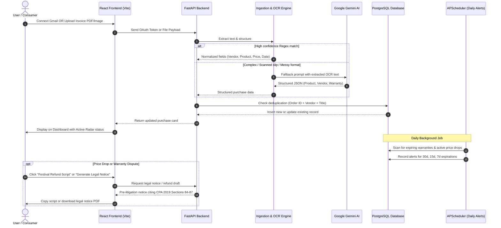

# Warranty Radar — Comprehensive Project Document & Product Guide
*Smart Warranty, Festival Price Drop Refund & Consumer Rights Radar for India*

---

## 1. Executive Summary

**Warranty Radar** is India's first autonomous consumer protection platform. It monitors your purchases across major retailers (Amazon India, Flipkart, Meesho, Croma, Apple, etc.), tracks warranty expiration dates, automatically scans for festival price drops during sales (Diwali, Big Billion Days) to secure price-match refunds, and empowers Indian consumers with a **1-click Legal Notice Generator** backed by the **Consumer Protection Act, 2019** whenever a brand unfairly delays or rejects a warranty claim.

---

## 2. The Problem: What Lags in Today's Indian Ecosystem vs. USA & China

### 2.1 The Indian Reality Today
Apps like **OneAssist, Onsitego, Cashify**, and OEM service apps (Samsung Care+, Mi Service) suffer from severe limitations:
1. **100% Manual Data Entry**: Users must painstakingly type product names, serial numbers, invoice numbers, warranty lengths, and upload receipt images one by one. If an active shopper buys 30–50 items a year across Amazon, Flipkart, Blinkit, and local stores, manual entry is completely impractical.
2. **Passive, Dead-End Reminders**: Existing apps operate merely as digital calendars. They ping you: *"Your TV warranty expires in 15 days"*, but provide zero assistance when a company gives excuses, blames "water/moisture damage", or delays repairs for months.
3. **No Price Protection in a Sale-Driven Market**: India is the world's most sale-driven e-commerce market (Amazon Great Indian Festival, Flipkart Big Billion Days, Diwali sales). Consumers often buy an item for ₹50,000 only to see it drop to ₹42,000 four days later. Indian apps offer no mechanism to detect these drops or recover the ₹8,000 difference.
4. **Intimidating Legal Barriers**: When an Indian consumer faces a defective product or a rejected claim, fighting back requires either hiring an expensive advocate or navigating complex legal paperwork. Companies take advantage of this friction, knowing 95% of consumers will simply give up.

### 2.2 How the USA and China Solved This
* **United States (DoNotPay, Earny, Capital One Price Protection)**:
  - **Earny & Capital One**: Connects directly to consumer mailboxes, tracks post-purchase price drops, and automatically files price-adjustment claims with retailers or credit card issuers.
  - **DoNotPay (The Robot Lawyer)**: Empowers consumers to fight warranty rejections and unfair charges with automated legal dispute letters citing statutory consumer protection laws (e.g., the Magnuson-Moss Warranty Act).
* **China (Alipay "Baoxian" & JD.com 30-Day Price Guarantee)**:
  - **JD.com (Jingdong)**: Built-in 1-tap price protection (*Jiabao*). If any item you purchased drops in price during a promotional sale, one tap refunds the difference directly back to your digital wallet.
  - **Alipay / Taobao Consumer Shield**: Standardized digital warranty passports linked to Alipay accounts that automatically schedule authorized home pickups for repairs.

---

### 2.3 Comparison Matrix: India vs. USA/China vs. Warranty Radar

| Dimension | Typical Indian Apps (OneAssist, Onsitego, etc.) | USA / China Benchmarks (DoNotPay, Earny, JD.com) | **Warranty Radar (Our System)** |
| :--- | :--- | :--- | :--- |
| **Receipt Collection** | Manual typing and manual photo uploads. | Automated mailbox & digital wallet scanning. | **Zero-touch Gmail OAuth auto-sync** + PDF/photo invoice parser. |
| **Price Drop Refunds** | Not available. | Automated price-match claims (Earny, JD.com). | **Festival Price Drop Radar** + 1-click price-adjustment script. |
| **Warranty Denials** | None. User is left stranded. | "Robot Lawyer" statutory legal dispute letters. | **1-Click Legal Notice** citing Indian Consumer Protection Act 2019 (Sec 84–87). |
| **Govt Dispute Redressal** | None. | Automated small claims court filing. | **Pre-formatted NCH 1915 & e-Daakhil filing packages**. |
| **Invoice / Slip OCR** | Rigid parser; fails on messy or thermal bills. | Vision LLMs and high-accuracy OCR. | **Hybrid 2-Tier Engine**: Instant Regex + **Google Gemini AI** + OCR. |
| **Manufacturer Navigation**| Generic customer care numbers. | Integrated brand repair portals. | **Direct product store links** & official brand service links (HP, Apple, etc.). |
| **Natural Language AI** | Basic keyword FAQ search. | Conversational AI concierge. | **Conversational Gemini AI agent** (strict English output). |

---

## 3. Comprehensive Feature Suite of Warranty Radar

Warranty Radar packages 11 core features that provide complete protection throughout the product lifecycle:

### Feature 1: Zero-Touch Gmail Purchase Tracker
- Connects directly to your Gmail account via secure Google Cloud OAuth 2.0 (`gmail.readonly`).
- Automatically filters and parses order confirmations from top Indian retailers: Amazon India, Flipkart, Meesho, Croma, Apple India, Ajio, Reliance Digital, and more.
- Extracts order numbers, item names, purchase dates, prices, and return windows in seconds.

### Feature 2: Multi-Format Invoice & Warranty Card Ingestion
- For purchases made offline (Reliance Digital, Vijay Sales, local electronics stores) or on messaging apps (WhatsApp invoices):
  - **Drag-and-Drop PDF Upload**: Reads standard multi-page tax and GST invoices.
  - **Photo OCR**: Scans photos of physical paper invoices, warranty cards, and thermal cash counter slips.
  - **Raw Text Parser**: Paste raw SMS confirmations or WhatsApp receipts to test extraction without saving.

### Feature 3: Smart Deduplication Engine
- Prevents database clutter and duplicate cards.
- Automatically compares incoming scans against existing records by combining **Order ID**, **Normalized Product Title**, and **Vendor**.
- If a receipt or email has already been processed, it updates the existing record with any missing details (e.g., warranty attachments) instead of creating duplicates.

### Feature 4: Festival Price Drop Refund Radar (US Earny for India)
- Actively checks your purchases against major festive discount events (Diwali sales, Big Billion Days, Great Indian Festival, Republic Day sales).
- Evaluates your remaining return window (standard 7–10 days in India).
- If a price drop is identified while your return window is active, it calculates your potential savings and generates a **ready-to-send retailer price-match script** citing Amazon/Flipkart refund policies.

### Feature 5: 1-Click Consumer Legal Notice Generator (US DoNotPay for India)
- When a company delays repairs, claims lack of spare parts, or falsely rejects a claim:
  - Generates a formal **15-Day Pre-Litigation Legal Notice** addressed to the company's Grievance Officer and Managing Director.
  - Specifically cites **Sections 84, 85, 86, and 87 of the Indian Consumer Protection Act, 2019** (Product Liability & Defective Goods).
  - Outlines the statutory liability: replacement, full refund with 18% p.a. interest, and compensation for mental harassment.

### Feature 6: National Consumer Helpline (NCH 1915) & e-Daakhil Filing Package
- For unresolved grievances:
  - Automatically formats the dispute into a structured complaint draft ready for the **National Consumer Helpline (NCH 1915 / consumerhelpline.gov.in)**.
  - Provides a checklist and step-by-step guidance for filing in District Consumer Disputes Redressal Commissions via **e-Jagriti / e-Daakhil (e-jagriti.gov.in)** without hiring an advocate.

### Feature 7: Direct Store Listing & Official Brand Support Routing
- Displays a direct shortcut to open the exact product listing on Amazon, Flipkart, or HP to check live sale pricing or initiate returns.
- Connects directly to manufacturer service portals (HP Support, Apple Support, Samsung Care, Boat Service) instead of routing users through generic homepages.

### Feature 8: AI Warranty Concierge (Conversational Assistant)
- Ask natural language questions like:
  - *"Which of my gadgets are expiring this month?"*
  - *"Does my HP laptop warranty cover battery replacement?"*
- Powered by Google Gemini Flash, responding concisely (under 150 words) with exact dates and product names.
- Enforces strict English output regardless of whether the user types in Hindi, Hinglish, or regional terms.

### Feature 9: Automated Daily Expiry & Return Window Alerts
- Background engine continuously evaluates all saved purchases.
- Flags items entering critical periods: **30 days, 15 days, and 7 days** before warranty expiration.
- Alerts users to active return windows before they close.

### Feature 10: 1-Click Claim Dossier & Proof Exporter
- Packages purchase details, invoice attachments, retailer information, and warranty coverage dates into a structured, printable claim dossier to present at service centers.

### Feature 11: Aurora Glassmorphism Responsive UI
- High-performance, modern interface with dark and light mode support.
- Animated radar scanning indicators, filter chips (All, Active, Expiring, Low Confidence), and responsive design for desktop and mobile browsers.

---

## 4. System Architecture & End-to-End Data Flow

The following sequence illustrates how Warranty Radar processes incoming data and delivers consumer protection:



---

## 5. Technology Stack & Why Each Tool Was Chosen

```
┌────────────────────────────────────────────────────────┐
│                   FRONTEND (Client)                    │
│   React 19  │  Vite  │  Tailwind CSS v4  │ Framer Motion │
└───────────────────────────┬────────────────────────────┘
                            │ REST API (JSON)
┌───────────────────────────▼────────────────────────────┐
│                   BACKEND (Server)                     │
│    Python 3.11  │  FastAPI  │  SQLAlchemy 2  │  Alembic  │
└──────┬────────────────────┬────────────────────┬───────┘
       │                    │                    │
┌──────▼──────┐      ┌──────▼──────┐      ┌──────▼──────┐
│  AI / OCR   │      │  DATABASE   │      │ BACKGROUND  │
│Google Gemini│      │ PostgreSQL  │      │ APScheduler │
│Tesseract OCR│      │  / SQLite   │      │ Daily Alerts│
└─────────────┘      └─────────────┘      └─────────────┘
```

### 5.1 Frontend (User Interface)
* **React 19**: Provides reactive, component-based UI rendering, ensuring real-time updates as scans finish.
* **Vite**: Modern build tool providing instantaneous hot-module replacement (HMR) and optimized, minified production assets.
* **Tailwind CSS v4**: Utility-first CSS framework with custom glassmorphism, linear gradients, and responsive layouts.
* **Framer Motion**: Smooth spring-based animations for cards, modals, and radar pulses.
* **Lucide React**: Clean SVG icon system for UI controls and statuses.

### 5.2 Backend (Application Server & API)
* **Python 3.11**: Industry standard for data extraction, document parsing, and AI integration.
* **FastAPI**: Asynchronous Python web framework offering high throughput, native async request handling, and automatic OpenAPI / Swagger documentation.
* **SQLAlchemy 2.0 ORM**: Modern object-relational mapping enabling type-safe database queries.
* **Alembic**: Database migration tool for version-controlled schema evolution without data loss.
* **APScheduler**: In-process background task scheduler managing daily warranty expiration and price-drop checks.

### 5.3 Document Parsing & AI Vision
* **pdfplumber & PyPDF2**: Deep inspection tools for extracting tabular text, order dates, and line items from PDF invoices.
* **Tesseract OCR & Pillow (PIL)**: Optical Character Recognition engine to convert photo receipts and warranty cards into machine-readable text.
* **Google Gemini API (`gemini-3.1-flash-lite` / `gemini-3.5-flash-lite`)**: State-of-the-art vision and language model providing intelligent fallback extraction for unusual invoices and powering the conversational assistant.

### 5.4 Database & Authentication
* **PostgreSQL (Production)**: Relational database hosted on cloud infrastructure, ensuring data integrity across users, purchases, warranty periods, and alerts.
* **SQLite (Local Development)**: Zero-configuration local database for testing.
* **Google Cloud OAuth 2.0 (`gmail.readonly`)**: Secure, token-based authorization. User passwords are never requested or stored; tokens can be revoked at any time.

### 5.5 Cloud Hosting & DevOps
* **Docker & Dockerfile**: Multi-stage containerization packaging the application for consistent behavior across all operating systems.
* **Render / Railway**: Container deployment platforms hosting the FastAPI backend and managed database.
* **Vercel / Netlify**: Global Content Delivery Networks hosting the frontend assets.

---

## 6. Testing, Quality & Code Health

* **Automated Test Suite**: 130 passing unit and integration tests covering:
  - Regex invoice extractors (Amazon, Flipkart, Meesho, Croma, Apple, generic)
  - Gemini LLM fallback handlers
  - Vendor normalizers and category warranty estimators
  - Alert scheduler triggers (30d, 15d, 7d expirations)
  - Legal notice generation and statutory reference verification
  - Authentication flows and duplicate prevention
* **Performance**: Zero-millisecond client-side price radar computation (`computeInstantRadar`) ensures immediate dashboard responsiveness without server latency.

---

## 7. Beginner-Friendly Glossary for Non-Technical Stakeholders

* **API (Application Programming Interface)**: The bridge allowing the frontend website to communicate securely with the backend server.
* **OAuth 2.0**: The industry-standard protocol that lets users connect their Gmail account safely with one click, without sharing their password.
* **OCR (Optical Character Recognition)**: Technology that reads text inside photos or scanned documents (like smartphone pictures of paper receipts).
* **LLM (Large Language Model)**: An advanced AI system (such as Google Gemini) that understands natural human language, reads unstructured text, and drafts coherent responses.
* **ORM (Object-Relational Mapping)**: A tool that translates Python objects into database rows and columns automatically.
* **Pre-Litigation Legal Notice**: A formal written warning sent to a company before filing a lawsuit, outlining the legal violations and giving them 15 days to resolve the matter.
* **e-Jagriti (formerly e-Daakhil)**: The official unified portal launched by the Department of Consumer Affairs, Government of India (`e-jagriti.gov.in`) enabling citizens to file consumer complaints online directly to District, State, or National Consumer Commissions without physically visiting a consumer court.

---
*Document Version: 1.0.0 — Warranty Radar Product Documentation*

